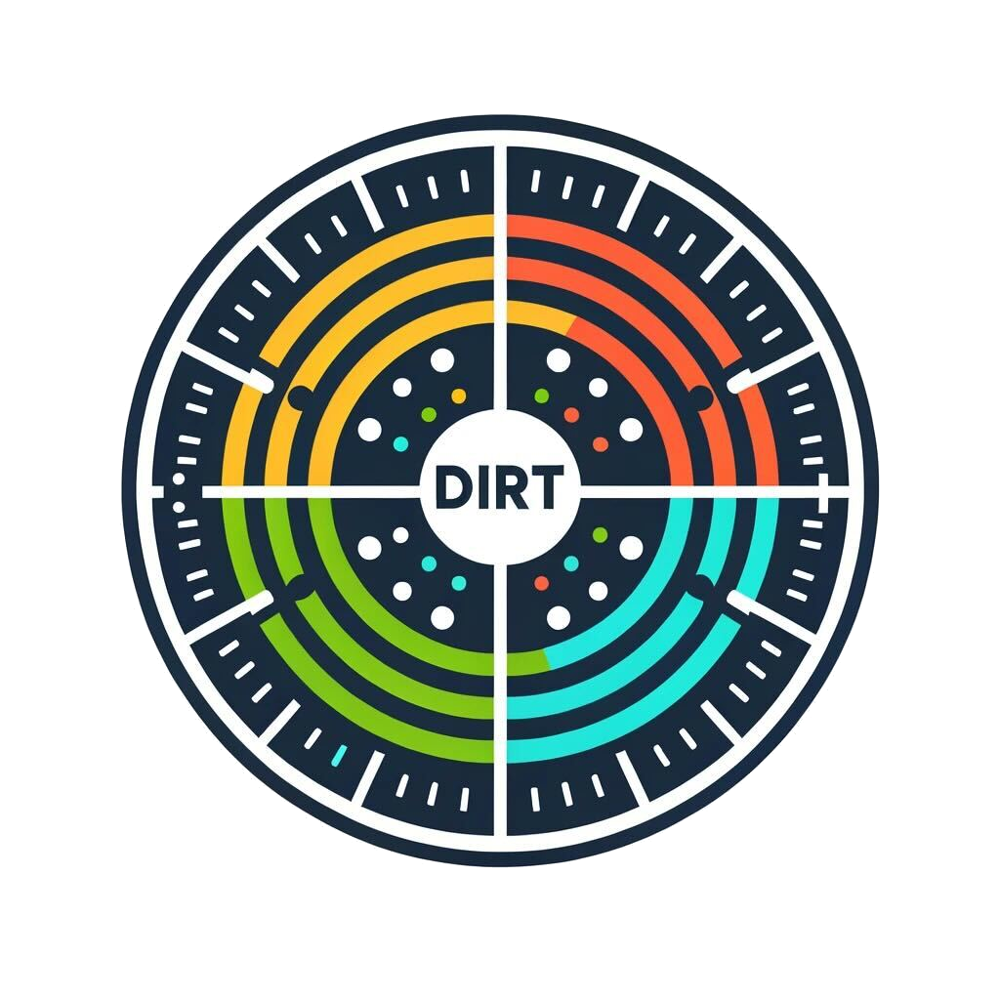

<h1>&nbsp; DIRT - Distributed Isochronous Roundtrip Tester</h1>

**Monitor network latency and jitter with precision across your distributed systems.**

<!-- Add Badges Here: e.g., Go Version, License, Build Status, Release -->
<!--  -->
<!--  -->
<!--  -->

D.I.R.T. (Distributed Isochronous Roundtrip Testing) is a powerful monitoring tool designed to continuously gather and analyze critical network latency metrics within your infrastructure.

## Why DIRT?

Understanding network performance is vital for application reliability and user experience. DIRT helps you:

*   **Pinpoint Bottlenecks:** Identify exactly where latency issues occur in your network paths.
*   **Proactive Monitoring:** Continuously track performance to detect degradations before they impact users.
*   **Validate Network SLAs:** Ensure your network meets the required performance standards.
*   **Understand Impact of Workloads:** Observe how different applications and traffic patterns affect network jitter and latency.
*   **Optimize Distributed Systems:** Gain insights needed to fine-tune communication between your services.

## Key Features

DIRT provides detailed observability metrics, including min, max, mean, median, and standard deviation for:

*   **Round Trip Time (RTT):** Total time for a packet to travel to a remote host and return.
*   **Send Delay:** Latency to send packets to a remote host.
*   **Receive Delay:** Latency to receive packets from a remote host.
*   **IP Packet Delay Variation (IPDV / Jitter):** Variation in delay for consecutive packets (round trip).
*   **Send IPDV:** Jitter for outbound packets.
*   **Receive IPDV:** Jitter for inbound packets.

IPDV (jitter) metrics are particularly useful for monitoring how different network workloads might conflict, such as low-latency small packets versus high-bandwidth traffic.

## How it Works

DIRT extends the capabilities of [IRTT (Isochronous Round-Trip Tester)](https://github.com/heistp/irtt) by making it distributed. It utilizes [Memberlist](https://github.com/hashicorp/memberlist) for cluster discovery and management, with intelligent filtering to manage complex network topologies.

<!-- Consider adding a simple architecture diagram here -->

## Getting Started

### Prerequisites

*   Go (version 1.18 or higher recommended)

### Installation

1.  Clone the repository:
    ```bash
    git clone https://github.com/StevenLeRoux/dirt.git
    cd dirt
    ```
2.  Build the binary:
    ```bash
    go build
    ```
    This will create a `dirt` executable in the current directory.

### Configuration

1.  Copy the sample configuration file:
    ```bash
    cp config.sample.yaml config.yaml
    ```
2.  Edit `config.yaml` to suit your environment. Key settings include:
    *   `group`: The group this node belongs to (e.g., `frontend`, `backend`).
    *   `peers`: A list of groups this node should attempt to connect with for monitoring.
    *   `listen`: Network interface and port for DIRT to listen on.
    *   `members`: List of known cluster members to join.

    Refer to the comments in `config.sample.yaml` for detailed explanations of all options.

### Running DIRT

Once configured, you can run DIRT:
```bash
./dirt -config config.yaml
```

DIRT will then start, attempt to join the cluster, and begin monitoring peers based on your configuration.

## Clustering and Topology

You can define topologies to control which nodes participate in monitoring sessions. Assign a node to a `group` and then define `peers` (a list of groups) with which this node will establish IRTT sessions.

For example, a `backend` node might only peer with `frontend` and `database` groups, avoiding unnecessary checks with other `backend` nodes if they don't directly communicate.

```yaml
# Sample config snippet from config.yaml
group: backend

peers:
  - frontend
  - database
```

This ensures that latency monitoring focuses on actual traffic patterns.

### Bootstrap Node

A node can be configured as a `bootstrap` node. Bootstrap nodes manage cluster membership but do not participate in latency monitoring tasks themselves.

### Rack Awareness (Planned)

Future versions will introduce rack awareness. This will allow electing specific nodes within a rack to monitor connectivity to elected nodes in other racks, optimizing the number of monitoring sessions while still providing comprehensive inter-rack latency data.

## Metrics Export

DIRT exposes its own operational metrics (e.g., number of cluster nodes) and detailed latency metrics. All metrics include labels for powerful aggregation and filtering (e.g., by source/destination node, rack, or group):

*   `node_source`
*   `node_destination`
*   `rack_source`
*   `rack_destination`
*   `group_source`
*   `group_destination`

Currently, DIRT integrates with [Beamium](https://github.com/clevercloud/beamium) for metrics export. Support for other systems (e.g., Prometheus) may be added in the future.

## Status

DIRT is under active development. While it's a powerful tool, it should be considered beta software. We welcome feedback and contributions!

## Contributing

We welcome contributions in all areas!

*   **Code & Features:** Help us build new functionalities or improve existing ones.
*   **Documentation:** Enhance our guides, examples, and explanations.
*   **Bug Reports & Testing:** Identify issues and help us make DIRT more robust.
*   **Logo & Design:** Have an idea for a new logo or visual improvements?

Please read our `CONTRIBUTING.md` (to be created) for guidelines on how to contribute.

## License

DIRT is licensed under the [Apache License 2.0](LICENSE). <!-- Create a LICENSE file -->

## Get in Touch

*   **Issues:** [GitHub Issues](https://github.com/StevenLeRoux/dirt/issues)
*   **Twitter:** [@GwinizDu](https://twitter.com/GwinizDu)